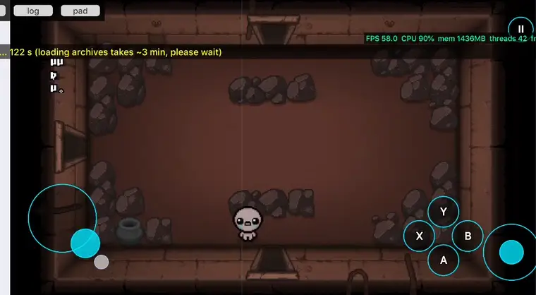
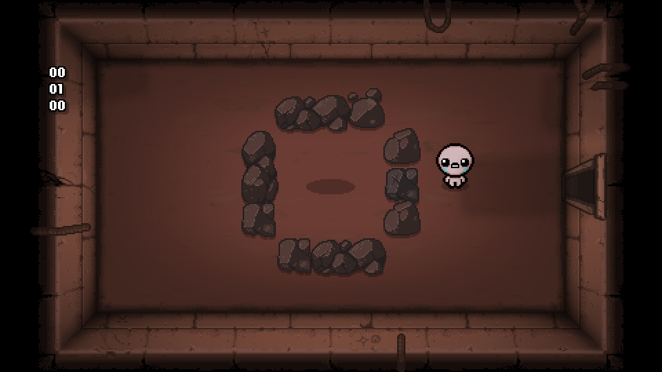
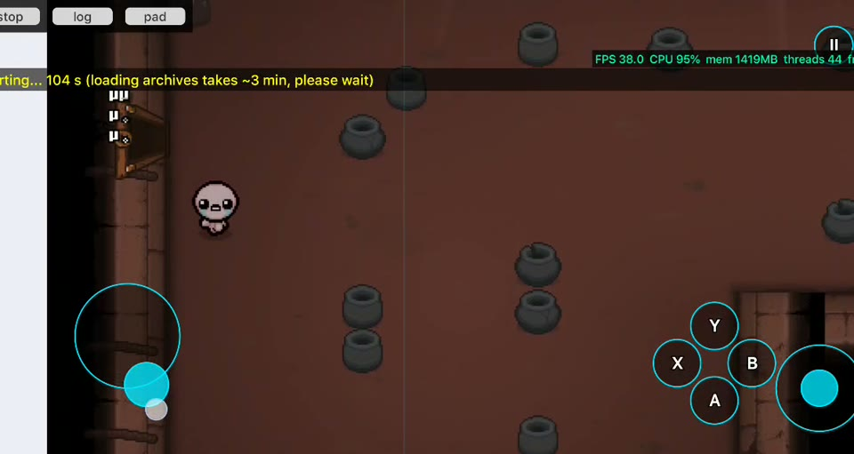

# 以撒：忏悔 → Android arm64

把 PC 版《以撒的结合：忏悔》(x86 PE32) 整个引擎静态重编译成 Android arm64
原生代码。**不是模拟器** —— 15,071 个 x86 函数在编译期翻译成 C，
交叉编译成原生 `.so`。

**现状：能启动、能玩、能打——但有两个看得见的缺陷。** 142 个采样中位帧率
56.9 fps；HUD 字体图集上传失败，密集房间会掉帧。两个根因都写在下面。

**发布：** [v0.1.1-alpha](https://github.com/chenxukk-web/isaac-arm64/releases/tag/v0.1.1-alpha)
——仅有源码，预发布。GitHub 侧栏对预发布只显示 `1 tag` 并链到 `/tags`
而不是 `/releases`，所以要看发布说明请走这个链接。

> **用 `v0.1.0` 构建出的 `.so` 无法启动**——它的 `host_main.c` 里是 app 沙箱
> 读不到的 Termux 绝对路径。已在 `v0.1.1-alpha` 修好；用那个 tag，不要用 `v0.1.0`。

## 在手机上是什么样子



实机录下的七秒。角色在走动、换了房间，帧率在 44–58 fps 之间抖动。
两个缺陷全程都在：所有 HUD 计数显示成 `µ` 而不是数字，`starting...` 永不隐藏。

| 2026-11-06 构建（HUD 正常） | 2026-11-13 构建（HUD 损坏） |
|---|---|
|  |  |
| HUD 计数正常渲染：`00 01 00` | 所有 HUD 计数都变成 `µ` —— 缺陷 #1 |
| 同类房间、同一台设备 | `starting...` 永不隐藏；这一帧 38 fps、95% CPU |

两张图来自同一台手机（Adreno 830 / Android 17）。房间、精灵和角色在两边都
正常渲染——中间回归的是字体图集上传，不是渲染器。

**实机 3 分钟演示：** https://youtu.be/V-F3hw618yU

---

**它是怎么做出来的：** 全程 AI 辅助，由一个人主导并跑完每一次实机测试。
文档和代码改动由 AI 根据日志和源码写出；没有任何 AI 亲手在设备上装过它。
如果这里的说法和你实测的结果冲突，相信你的测量。

---

> **维护状态：原作者已不再开发。**
> 本项目在此状态下发布，供他人接手、构建、改进。
> 作者目前**只做测试——专门找坑和 bug——并把发现记进这份归档**。不再计划
> 新功能，也不计划修复缺陷。下面所有内容都是某一次的实测快照，不是承诺。
>
> **为什么不再开发：** 整个移植是在**一台跑 Termux 的安卓手机上**做的——没有 PC、
> 没有 CI。每次改动都要全量重编 192 个翻译单元（10-20 分钟），然后手动装 APK、
> 手动测试。一次迭代 20-30 分钟而且大部分是等待，而剩下两个缺陷各自都需要很多次
> 迭代。细节见 `LIMITATIONS.md` §8.0。
> **在桌面电脑上这个项目完全不同**——那次重编只要几分钟，而且 ADB 可以代替手动
> 安装。
>
> **作者归属：** 这个包里每一份文档都是 AI 跨多轮会话写的，依据是设备日志和源码。
> 包括本 README、`PITFALLS.md`、`BUILD_SPEC_FOR_AGENTS.md`、`DISTRIBUTION.md`、
> `LIMITATIONS.md`、`ANNOUNCEMENT.md`。人定方向、并在设备上跑每一次测试；AI 负责
> 代码改动、分析和文字。
>
> 这意味着：测量结果能追溯到日志或可重跑的命令，但**解读不是第一手的**。没有任何
> AI 在设备上装过这个东西（原因见 `LIMITATIONS.md` §8e）。凡文中说法与你的实测
> 冲突，以你的实测为准。独立参照是上游
> [`repentogxm`](https://github.com/0xl0cal/repentogxm)——本项目是它之上加的一层
> 宿主层。

---

## ⚠ 先读免责声明

**本包不含游戏本体和资源。** 你必须自备正版《以撒的结合：忏悔》。

本项目按「现状」提供，无任何担保。原作者已不再开发，也不提供技术支持；作者目前只做测试，测试发现的东西会记进这份归档。

使用修改版客户端**可能**违反游戏 EULA 或 Steam 用户协议，可能导致成就失效、
云存档冲突或账号受限 —— **这一风险由使用者自行承担**。

设备损坏、数据丢失等风险同样自负。

完整条款见 **[`DISCLAIMER.md`](DISCLAIMER.md)**。它不是法律意见；
如果你打算再分发或商用，请咨询执业律师。

---

## ★ 从 `PROJECT.md` 开始

只读一份的话就读它：一页纸的总览——这个移植是什么、在上游之上加了什么、一段话
讲清架构、实测状态、已知缺陷、哪些没验证、为什么不再开发、构建需要什么。它是写给
第一次接触这个项目的人看的。

本 README 余下部分假设你已经知道这个项目是什么了。

---

## ★ 第二份读 `PITFALLS.md`

**这份文档是本项目最有价值的部分。**

收录了全部踩过的坑，按代价排序，每条都附当时的证据（地址、日志、数字）：

- 构建期：基址必须二次平移、`-DSTATICLIB=ON` 漏了链接失败、
  `--version-script` 漏了导出 3 万个符号
- ABI：GL 桥把 275 个入口的浮点参数当整数传、JNI 指针少一个参数导致真机崩溃
- 分配器：返回"不足的块"比返回 NULL 危险一百倍、失败分支推进指针
- Android：`access()` 在 FUSE 上撒谎、进程内禁 `dup2`、符号链接不进 APK
- 诊断方法论：主动调 GL 的探针会崩、信号处理器"看起来没执行"的两个原因
- 性能：诊断探针拖垮性能的四个真实数字、静态指令数 ≠ 性能
- **被否决的路线**：换 MobileGlues 为什么不行、按指针重放纹理会串图

**读一遍能省两周。**

---

## ★ 启动时间有单独的文档

`STARTUP_AND_ARCHIVES.md` 讲的是唯一一个已被完整测明的性能问题：那 ~17.5 秒
启动到底花在哪、从零售归档里恢复出来的 `ARCH000` 容器格式，以及一个能把启动
降到 **8 秒**的重新打包方案——已实测——但它会崩，崩在一个既有的内存 bug 上，
而那个 bug 是被文件大小变化触发的。文档里还记了一件事：**什么都没有缓存**。
每次启动都重新把同样的 1.2 GB 当翻译过的 x86 跑一遍，代价是原生 zlib 的 7 倍。

如果你打算碰启动、归档或资源层，先读它。

---

## ★ 然后读 `LIMITATIONS.md`

`PITFALLS.md` 记的是**踩到并解决**的坑；`LIMITATIONS.md` 记的是项目停手时
**还没结论**的部分——正是它让这次发布保持诚实：

- **能启动，不等于能通关。** 翻译器对没实现的指令会生成 loud stub。普通房间
  走不到已翻译集合的全部；结局和奇怪的道具组合会。没有任何一次记录的运行
  走到结局，所以"能通关"是未证。
- **Vita 移植的数字在这里不适用。** "81 MiB 堆""27 分钟后 OOM""33-34 fps"
  都是 Vita 的数字。本构建的 guest 堆上限是 2640 MB，142 个采样的实测中位是
  56.9 fps。
- **x87 用 `double` 建模，不是 80 位。** 生成代码里约 750 处 FPU 栈操作加 331 处
  算术。本平台的 `long double` 是 binary128（113 位），所以修法是现成的且已
  验证——但要重编全部 192 个 `gen/` 单元，而且没有东西证明当前构建是错的。
- **不存在行为一致性测试。** 字节相同的目标文件只证明注释翻译是干净的，
  不证明程序行为与 PC 原版一致。
- **从未加载过任何 Mod。** 所有记录的运行里 `mods/` 都是空的。三个宿主层缺陷
  （非 ASCII 名、同时 8 个目录句柄、`*.ext` 之外的通配符）会一次性弄坏很多 Mod。

那份文件里每条都标了 **实测** 或 **未验证**，并附带自己复验的命令。
"未验证"那几行请当成待办事项读，不要当成安慰。

**第 8 节是实操部分：** 哪些事没做、每处改动落在哪个文件的哪一行、构建步骤
实测要多久（编译 0.24 秒、链接 0.43 秒、重打包 1.78 秒），以及为什么一件都
没被验证。短答案：原作者停手了，而写这些文档的工具链在设备上**装不了 APK**
——从 Termux 里 `pm install` 被 SELinux 拒绝，而且它构建的那个 APK 是一次性
临时产物，从未发布。所以这里没有任何东西经过运行期验证。这个限制适用于整个
压缩包，不只是那些没做完的工作。

注意这背后的链条：**本压缩包不包含任何能直接运行的产物。** 要在设备上验证，
你得自己构建 `.so` 和 APK（S7/S8），点一下安装；之后宿主层的改动只需替换
外置 `.so`，不用重装。

---

## 参与、反馈，或接手

`CONTRIBUTING.md` 说明了什么值得报、什么不值得。其中有两条值得你在花时间之前
先知道：

- **构建有两个构建规范里没写的依赖。** `host_lua.c` 需要 Lua 5.3.3 的头文件，
  而 Termux clang 会注入一条契约不允许的 RUNPATH。`tools/build_and_check.sh`
  会编译、链接、检查全部四条契约外加 PE 路径，并剥掉那条 RUNPATH——
  在 `obj_pic/` 已存在的前提下，手机上 8 秒跑完。
- **崩在 `fault_addr=0x87e7fff0` 不是你的改动造成的。** 那是
  `STARTUP_AND_ARCHIVES.md` §3.3 里描述的既有越界写，任何足以改变内存布局的
  改动都会触发它。

---

## 中文版和英文版的区别

两份的**代码完全相同**，各自都有自己的 `source/`。区别只在文档与注释语言：

| | 本目录（zh/） | 仓库根目录（en） |
|---|---|---|
| 运行时日志 | 英文 | 英文 |
| 八份文档 | **中文** | 英文 |
| 源码注释 | **中文**（原始排查记录） | 英文（全部翻译） |

（发布压缩包里这两份是 `isaac-arm64-en/` 与 `isaac-arm64-zh/` 两个目录，
内容相同。）

**注释不进编译产物。** 这一点已用目标文件比对验证：两棵树的全部 20 个
宿主源文件各编一次，生成的 `.o` **逐字节相同，20/20**。所以两个包构建出的
`.so` 功能完全一致。

**为什么日志是英文而文档是中文**：日志要给 AI/脚本解析（中文标签与数字混排
噪音大），文档是给人读的。这个组合是刻意的。

---

## 现状（真机实测）

| 项 | 值 |
|---|---|
| 可玩性 | 可玩——帧率见下一行 |
| 帧率 | **中位 56.9 fps**，142 个 `[perf]` 采样（P10 43.6，最高 60.4）。表格下方提到的 58-60 fps 是较早构建的数字。 |
| 崩溃 | 当前构建无（实测到第 8400 帧，SEGV 计数 0）。两次 `std::bad_alloc` 中止发生在 2026-11-10 堆上限调整**之前**——见 `LIMITATIONS.md` 第 2 节。 |
| 启动 | **约 17.5 s，其中几乎全是翻译成 x86 的 `inflate()`**（多次运行 16.4-21.2 s）。同样 1.2 GB 原生 zlib 只要 2.5 秒。启动之间无任何缓存——见 `STARTUP_AND_ARCHIVES.md` |
| 验证设备 | **Adreno 830 / Android 17**（骁龙 8 Elite 级，仅此一台） |
| GL | gl4es 1.1.7，GL 2.1 → GLES 2.0 |

**只在唯一一台设备上验过。** 其他 GPU 是未知数。

**演示录像（3 分钟，真机）：** https://youtu.be/V-F3hw618yU
——在下面这台设备上录的。它把「两个已知缺陷」原样拍了下来：HUD 数字渲染成
`µ`、菜单列表空白。

58-60 fps 那个最好情况是在 2026-11-12 之前的构建上测到的。当前构建带着那天
新加的诊断探针，实测更慢；`LIMITATIONS.md` 第 3 节记录了证据和修法（去掉探针
重编）。

---

## 两个已知缺陷（根因定位，均未修复）

### 1. 部分 UI 贴图为空 → HUD 数字全渲染成同一个 `µ`、主菜单列表空白

真机实测：538 张上传纹理中 105 张全零（19.5%）。
其中**一部分是正常的离屏画布**（见下"陷阱"），真缺陷的确证例子是字体图集：

```
[alphachk] id=83 512x128 rgb_nonzero=0 alpha_nonzero=0 -> decoder wrote nothing (all zero)
```

已排除 6 种原因（数据层用独立 PNG 解码器逐字节对照，65062 == 65062 个非零
字节，证明解码完全正确）。

**当前线索**：字体图集的上传返回地址是 `0x5b0a13`，但它**不在**
`SetTexelData` 的 6 个已知调用点里（6 个中有 4 个计数为 0）。
说明存在第七条还没插探针的路径。

### 2. 实体密集房间掉帧

真机实测：帧时间 ≈ 3.21 ms + 0.88 ms × 每帧离屏 RT 的 draw 次数。
每次离屏 draw **879 μs**，正常 GLES draw 应 20-50 μs。

**根因已定位**：
- 游戏**零 VBO**（7800 帧无一次 `glGenBuffers`/`glBufferData`）
- 用 client-side vertex array，`glVertexAttribPointer` 全程只调 1 次
- gl4es 在 ES2 + shader 路径下把 guest 指针原样交给驱动
  （`src/gl/drawing.c:427-433`），无中间层
- 驱动每次 draw 都从 CPU 内存重读顶点并转换

**改法明确但未实施**：gl4es 的 `ToBuffer()`（`src/gl/gl4es.c:707`）支持
interleaved 布局，正好匹配 Isaac 的 `vec2 Position / vec2 UV / vec4 Color`。
它被 `glstate->vao->locked==1` 门住（只有游戏调 `glLockArraysEXT` 才触发）。
在 `drawing.c` 分发前加一条路径，ES2 + shader + client array 时无条件走
VBO 缓存。

---

## 构建

**看 `BUILD_SPEC_FOR_AGENTS.md`。** 那是给 AI 代理写的构建规格，
包含每个阶段的输入/输出契约、可机器检查的判据、8 个陷阱。

为什么给规格而不是脚本：原始构建在 Termux/arm64 上完成，你在 x86 上要
交叉编译，路径、工具链、sysroot 全不同。规格让 AI 生成适配你机器的构建系统。

### ⚠ `runtime_patched/` 必须用

本项目的 `gen/*.c` 编译时 `-I` 上游 repentogxm 的 `recomp/runtime`，
并且**我们修改了其中 3 个文件**：

```
guest.c        加了大量诊断日志（堆/UAF/野地址/栈失衡取证），日志已英文化
guest.h        加了内联检查与 vtable 监视的钩子
guest_pe.h     PE 期望值
```

**用法**：从上游 repentogxm 取 `recomp/runtime`，用这三个文件覆盖同名文件，
否则编译产物与本文档描述的诊断行为不一致（可能编不过，或行为不同）。

**你需要自备**：正版 PC 版 v1.7.9b (J835)。
校验：脱壳后 8,650,240 字节，
sha256 `31846486979cfa07c8c968221553052c3ff603518681ca11912d445f96ca9404`。

**游戏资源（约 1 GB）不分发**，从你自己的 PC 安装复制。

---

## 被否决的方案：换 MobileGlues

实测否决，记录在此省得重走：

1. **它的 shader 转换管线拒绝 Isaac 的 GLSL**（4/4 失败）。Isaac 用 GLSL 1.10
   legacy（`varying`/`attribute`/`gl_FragColor`/`texture2D`，且无 `#version`）。
   补上 `#version 120` 也失败，原因是 glslang 硬限制：
   `compilation for SPIR-V does not support the compatibility profile`
2. **不支持 client-side vertex array**：后端 context 恒为 GLES 3，
   GLES 3 取消了 client-side array，而 Isaac 零 VBO → 所有几何画不出来
3. 失败还是静默的：转换失败返回原始 GLSL，`ignore_error=Partial` 把
   `COMPILE_STATUS` 改成 `GL_TRUE`

---

## 关键陷阱（完整 8 条在规格书）

- **基址必须平移**：`gen_all.py --image-base` 只支持 0x30000000 和 Vita 的
  0x98000000，必须先生成再文本平移到 0x3C000000，且要包含 `host_*.c`
- **链接必须加 version-script**：否则导出 31,104 个符号污染 ART 符号空间
- **Android FUSE 上 `access()` 撒谎**：文件开关必须用 `fopen` 探测
- **主动调 GL 的探针会崩进程**：读 guest 内存安全，调 GL 不安全
- **用 CPU 侧读数判断纹理好坏会把 FBO 附件判成坏图**

---

## 许可

| 组件 | 许可 |
|---|---|
| 本项目（host 层 + gen 产物） | **GPL-2.0-or-later** |
| 上游 repentogxm 工具链 + runtime 头 | GPL-2.0-or-later |
| gl4es | MIT |
| Lua 5.3.3 | MIT |
| OpenAL Soft 1.23.1 | **LGPL-2.1**（分发需动态链接 + 附全文 + 提供源码） |

GPL 义务的由来：`gen/*.c` 编译时 `-I` 上游 `recomp/runtime`，直接使用其
`guest.h`。这是衍生关系。

**发源码没有额外负担。** 本项目只发源码，不发构建产物。
